<p align="center">
  
</p>

<p align="center">
  <b>We build a real online shop backend, break it on purpose in hundreds of ways, and train an AI detective to explain every break with proof.</b>
</p>

<p align="center">
  
  
  
  
  
</p>

<p align="center">
  <a href="#the-idea-in-one-minute">Idea</a> &nbsp;·&nbsp;
  <a href="#how-it-works">How it works</a> &nbsp;·&nbsp;
  <a href="#what-you-will-see-at-the-end">End result</a> &nbsp;·&nbsp;
  <a href="#repository-layout">Layout</a> &nbsp;·&nbsp;
  <a href="ROADMAP.md">Roadmap</a> &nbsp;·&nbsp;
  <a href="docs">Docs</a>
</p>

<br>

## The idea in one minute

Car companies crash their own cars into walls on purpose. The car is full of sensors, and because the engineers caused the crash themselves, they know **exactly** what happened. That is how they learn whether the airbags really work.

Faultline does the same thing for software.

1. We build a small but real online shop backend: a front door, an orders service, a payments service, a database.
2. A **chaos controller** breaks it on purpose. It slows down the database, crashes a service, makes payments fail, sends the same payment twice.
3. Every time it breaks something, it **writes down the answer in a sealed envelope**: which service, what kind of failure, when it started.
4. An **AI detective** looks only at what the system recorded (logs, metrics, traces) and tries to say what broke, where, and why.
5. Every sentence the detective writes must point to a real piece of evidence. If it cannot point to evidence, the sentence is deleted.
6. Then we open the envelope and check whether the detective was right. We do this hundreds of times and get a real accuracy number.

That last step is the whole point. Most "AI for incidents" projects cannot tell you how often they are right. Faultline can, because it caused every incident itself.

<br>

## Why this is hard and why it matters

When a big website goes down at 3 AM, an engineer gets woken up and has to answer one question fast: **what broke?**

The problem is that one broken part makes many healthy parts look broken too. If the payments service is slow, the orders service also looks slow, and the front door looks slow too. Everything is on fire at once, and only one thing actually started the fire. Finding that one thing is called **root cause analysis**.

AI can help, but AI also makes things up. An AI that confidently blames the wrong service is worse than no AI at all. So Faultline has two rules:

<table>
  <tr>
    <td width="50%"><b>Rule 1: Measure it</b><br>We only trust the detective because we tested it against hundreds of incidents where we already knew the answer.</td>
    <td width="50%"><b>Rule 2: Prove it</b><br>Every claim cites a trace ID, a log line, or a metric query. A separate checker reruns each citation. No proof, no claim.</td>
  </tr>
</table>

<br>

## How it works

```
   ╔══════════════════════╗
   ║   SHOPPERS (load)    ║   a robot that keeps placing fake orders, all day
   ╚══════════╤═══════════╝
              │
              ▼
   ╔══════════════════════╗        ╔══════════════════════╗
   ║   THE SHOP           ║◀═══════║   CHAOS CONTROLLER   ║  breaks things on purpose
   ║   gateway            ║        ║   writes the answer  ║  and seals the answer away
   ║   orders             ║        ║   into a hidden table║
   ║   payments           ║        ╚══════════╤═══════════╝
   ║   postgres           ║                   │
   ╚══════════╤═══════════╝                   │ answer key
              │ logs, metrics, traces         │ (only the scorer may read it)
              ▼                               │
   ╔══════════════════════╗                   │
   ║   OBSERVABILITY      ║                   │
   ║   Prometheus  Loki   ║                   │
   ║   Tempo  Grafana     ║                   │
   ╚══════════╤═══════════╝                   │
              │                               │
              ▼                               │
   ╔══════════════════════╗                   │
   ║   AI DETECTIVE       ║                   │
   ║   1 investigate      ║                   │
   ║   2 verify evidence  ║                   │
   ║   3 write report     ║                   │
   ╚══════════╤═══════════╝                   │
              │ report with citations         │
              ▼                               ▼
   ╔══════════════════════════════════════════════════╗
   ║   SCORER: compare the report with the answer key  ║
   ║   top 1 accuracy, top 3 accuracy, time, cost      ║
   ╚══════════════════════════════════════════════════╝
```

The single most important design rule: **the detective must never see the chaos controller.** The controller sends no logs, metrics or traces into the observability stack, and the detective has no access to the answer table. If it could peek, the accuracy number would be a lie.

<br>

## The three signals, explained simply

<table>
  <tr>
    <th>Signal</th>
    <th>What it is</th>
    <th>Everyday comparison</th>
  </tr>
  <tr>
    <td><b>Metrics</b></td>
    <td>Numbers measured every few seconds: requests per second, error rate, how slow the slowest 5% of requests are (p95).</td>
    <td>The speedometer and fuel gauge on your car dashboard.</td>
  </tr>
  <tr>
    <td><b>Logs</b></td>
    <td>Text lines each service writes when something happens: "payment captured", "request failed".</td>
    <td>A diary every service keeps.</td>
  </tr>
  <tr>
    <td><b>Traces</b></td>
    <td>The full journey of one request across every service, with timing for each step. Each step is called a span and has an ID.</td>
    <td>A parcel tracking page showing every hub the parcel passed through and how long it waited at each one.</td>
  </tr>
</table>

<br>

## What gets built

<table>
  <tr>
    <th width="50%">The platform (systems side)</th>
    <th width="50%">The AI engine (AI side)</th>
  </tr>
  <tr>
    <td valign="top">

* Order and payment microservices: gateway, orders, payments, later inventory, notifications and ledger
* A message queue (NATS or Kafka), the outbox pattern and sagas for multi step orders
* Idempotency keys so a retried payment can never charge twice
* Retries with backoff and jitter, timeouts, circuit breakers, dead letter queues
* Postgres designed for concurrency, Redis cache with a written invalidation strategy
* OpenTelemetry traces, structured logs, Prometheus metrics
* Kubernetes, CI/CD, load tests, written trade off documents
* The chaos controller and its fault catalogue

</td>
    <td valign="top">

* An investigator agent that calls tools against Prometheus, Loki and Tempo, the way a human SRE would
* RAG over runbooks, past incidents and the platform source code
* A small fine tuned model that compresses huge trace and log windows into structured incident signals, published on HuggingFace with its dataset
* A verifier that rechecks every citation and deletes any claim without proof
* An eval harness: top 1 and top 3 root cause accuracy, time to diagnosis, cost per investigation

</td>
  </tr>
</table>

<br>

## The fault catalogue

These are the ways we break the shop. Each one is recorded as ground truth.

<table>
  <tr><th>Fault</th><th>What happens</th><th>What it looks like from outside</th><th>Phase</th></tr>
  <tr><td><code>latency</code></td><td>A service waits before answering</td><td>Everything upstream gets slow too</td><td>1</td></tr>
  <tr><td><code>error</code></td><td>A service fails a share of requests</td><td>Errors appear in several services at once</td><td>1</td></tr>
  <tr><td><code>crash</code></td><td>A service process dies and restarts in a loop</td><td>Callers see "connection refused"</td><td>1</td></tr>
  <tr><td><code>db_slow</code></td><td>Database queries of one service become slow</td><td>Looks like plain latency unless you read the spans</td><td>1</td></tr>
  <tr><td><code>duplicate</code></td><td>The same payment message is delivered many times</td><td>Should cause zero extra charges if idempotency works</td><td>1</td></tr>
  <tr><td><code>poison_message</code></td><td>A message that always crashes its consumer</td><td>Queue backs up, dead letter queue fills</td><td>2</td></tr>
  <tr><td><code>network_partition</code></td><td>Two services cannot reach each other</td><td>Timeouts and circuit breakers open</td><td>2</td></tr>
  <tr><td><code>clock_skew</code></td><td>One service believes it is a different time</td><td>Expired tokens, odd ordering</td><td>2</td></tr>
  <tr><td><code>bad_deploy</code></td><td>A new version with a bug goes live</td><td>Errors start exactly at deploy time</td><td>2</td></tr>
  <tr><td><code>cache_stampede</code></td><td>Cache empties and everyone hits the database</td><td>Database load spikes, latency follows</td><td>2</td></tr>
</table>

<br>

## What you will see at the end

When Faultline is finished, anyone can run one command and watch this happen:

1. The shop runs with a robot placing orders every second.
2. The chaos controller quietly slows down the payments database.
3. Grafana dashboards turn red across several services.
4. The AI detective produces a short report like this:

```
ROOT CAUSE   payments  /  db_slow                     confidence 0.91

payments is waiting on its database: database p95 moved from 4 ms
to 352 ms [E7], and database spans own the most self time in 18 of
20 sampled slow traces [E4] [E5].

Alternative  orders  /  latency   (symptom, slower because it waits on payments)

Verifier     3 claims checked, 0 uncited, 0 rejected
Answer key   payments  /  db_slow   MATCH
```

5. After hundreds of runs, a results page shows numbers like:

<table>
  <tr><th>Measure</th><th>Target</th></tr>
  <tr><td>Root cause correct as first guess (top 1)</td><td>reported over 500 injected incidents</td></tr>
  <tr><td>Root cause in the first three guesses (top 3)</td><td>reported over 500 injected incidents</td></tr>
  <tr><td>Claims in final reports without evidence</td><td>0</td></tr>
  <tr><td>Duplicate charges under 10x message redelivery</td><td>0</td></tr>
  <tr><td>Checkout p95 latency at a fixed requests per second</td><td>measured with load tests</td></tr>
  <tr><td>Time and cost per investigation</td><td>measured per run</td></tr>
</table>

Numbers are only written into this README after they are measured. No made up results.

<br>

## Repository layout

```
faultline/
├── README.md                 you are here
├── ROADMAP.md                phases, tasks, owners, exit criteria
├── LICENSE
├── assets/
│   ├── banner.svg            animated banner at the top of this page
│   └── logo.txt              plain text logo
├── platform/                 systems side: the shop that gets broken
│   ├── README.md
│   ├── services/
│   │   ├── gateway/          front door, accepts checkouts
│   │   ├── orders/           creates orders, reserves stock, runs the saga
│   │   ├── payments/         charges exactly once using idempotency keys
│   │   ├── chaos/            injects faults, writes the sealed answer key
│   │   └── loadgen/          robot shoppers that keep traffic flowing
│   └── deploy/               compose now, Kubernetes later
├── engine/                   AI side: the detective
│   ├── README.md
│   ├── investigator/         pulls metrics, logs, traces and ranks suspects
│   ├── verifier/             rechecks every citation, deletes unproven claims
│   ├── evaluation/           runs hundreds of incidents and scores them
│   └── dataset/              labelled incidents, published to HuggingFace
├── docs/                     Mintlify documentation site
└── .github/
    └── ABOUT.md              repo description, topics, website
```

Every folder has its own README that explains what goes there, who owns it, and what "done" means.

<br>

## Where to start

<table>
  <tr>
    <th width="50%">Platform owner, first week</th>
    <th width="50%">AI owner, first week</th>
  </tr>
  <tr>
    <td valign="top">

1. Pick the stack and write it in `platform/README.md`
2. Run Postgres plus the Grafana LGTM stack with Docker Compose
3. Build gateway, orders, payments with OpenTelemetry from day one
4. Add the `faults` table and a chaos service that supports `latency` and `error`
5. Hand over: Grafana shows traces across all three services

</td>
    <td valign="top">

1. Write small clients for Prometheus, Loki and Tempo
2. Define the evidence format: every finding gets an ID like `E7`
3. Build the verifier first, before any LLM, and unit test it
4. Build a simple rule based investigator as the baseline
5. Hand over: one fault injected, one report produced, scored against the answer key

</td>
  </tr>
</table>

The handshake between both sides is small on purpose: **the platform exposes telemetry and a fault API, the engine reads telemetry and is scored against the fault table.** Neither side needs to wait for the other to be finished.

Full plan with every phase and task: [ROADMAP.md](ROADMAP.md).

<br>

## Documentation

The full docs live in [`docs/`](docs) and are built with [Mintlify](https://mintlify.com).

```bash
npm i -g mint
cd docs
mint dev
```

Then open `http://localhost:3000`.

<br>

## Glossary

<table>
  <tr><td><b>Microservice</b></td><td>A small program that does one job and talks to others over the network.</td></tr>
  <tr><td><b>Root cause</b></td><td>The one thing that actually started the problem, as opposed to everything that looks broken because of it.</td></tr>
  <tr><td><b>Chaos engineering</b></td><td>Breaking your own system on purpose, safely, to learn how it fails.</td></tr>
  <tr><td><b>Ground truth</b></td><td>The correct answer, known for certain, used to grade a guess.</td></tr>
  <tr><td><b>Idempotency key</b></td><td>A unique ticket number on a request so doing it twice has the same effect as doing it once.</td></tr>
  <tr><td><b>Saga</b></td><td>A multi step process where each step can be undone if a later step fails.</td></tr>
  <tr><td><b>Outbox pattern</b></td><td>Saving "send this message" in the same database transaction as the data, so messages are never lost.</td></tr>
  <tr><td><b>p95 latency</b></td><td>95% of requests are faster than this number. It shows how slow things feel for unlucky users.</td></tr>
  <tr><td><b>RAG</b></td><td>Letting an AI look things up in documents before answering, instead of relying on memory.</td></tr>
  <tr><td><b>Hallucination</b></td><td>When an AI states something confidently that is not true.</td></tr>
</table>

<br>

## License

MIT. See [LICENSE](LICENSE).
