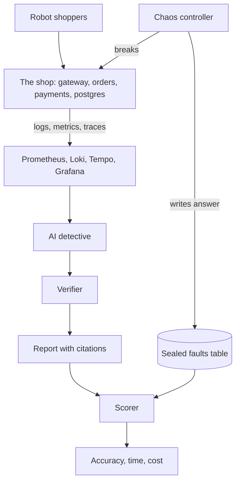

## The loop

## Step by step

<Steps>
  <Step title="Traffic">
    A load generator keeps placing orders so there is always something to observe.
  </Step>
  <Step title="Chaos">
    The chaos controller picks a service and a fault kind, for example slow database in payments, and records it as ground truth.
  </Step>
  <Step title="Symptoms">
    The fault spreads. Callers get slow or fail too. Dashboards turn red in several places at once.
  </Step>
  <Step title="Investigation">
    The detective queries metrics, logs and traces for the incident window and compares them with the minutes before. Every finding is saved as evidence with an ID like `E7`.
  </Step>
  <Step title="Verification">
    The verifier reruns each cited query, refetches each span and finds each log line again. Claims with missing or failed evidence are removed.
  </Step>
  <Step title="Scoring">
    The scorer opens the sealed answer and checks the first guess and the first three guesses.
  </Step>
</Steps>

## Telling cause from symptom

When payments is slow, orders and gateway look slow too. The detective separates them with traces:

* **Errors**: the deepest failing span in a request points at where the failure started
* **Latency**: the span that spends the most time on its own work, not waiting on children, points at the slow service
* **Crashes**: a call that fails without ever reaching a server span points at the service that is down
* **Slow database**: the slow self time sits inside a database span

<Warning>
The detective never sees the chaos controller. It sends no telemetry and its table is off limits during investigations. If the detective could peek, the score would mean nothing.
</Warning>
